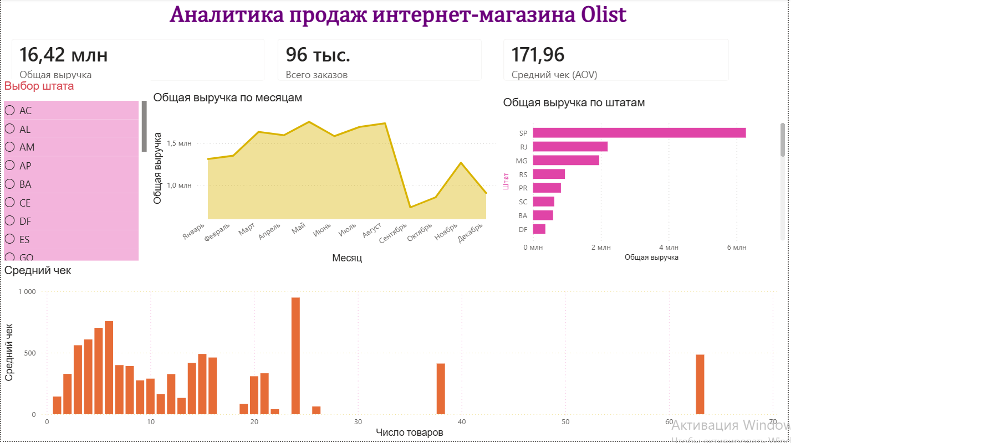

# 📊 Сквозной проект: Аналитика бизнес-показателей e-commerce (Olist)

[](https://python.org)
[](https://sqlite.org)
[](https://microsoft.com)
[](LICENSE)

## ⚡ Executive Summary (Главные выводы)
1. **Географическая концентрация:** Штат Сан-Паулу (SP) генерирует **38.2%** всей выручки маркетплейса, при этом медианный чек в SP статистически значимо отличается от остальных регионов ($p < 0.0001$).
2. **Критически низкий Retention:** Удержание клиентов во 2-й и последующие месяцы составляет менее **1%**, что указывает на модель разовых покупок и необходимость запуска программ лояльности.
3. **Факторы среднего чека:** Модель линейной регрессии объясняет **23.3%** дисперсии выручки заказа ($R^2 = 0.233$); ключевыми драйверами выступают количество позиций в корзине и стоимость логистики.

---

## 📑 Оглавление
- [1. Постановка задачи, источник данных и стейкхолдеры](#1-постановка-задачи-источник-данных-и-стейкхолдеры)
- [2. Структура репозитория](#2-структура-репозитория)
- [3. Ключевые этапы и результаты анализа](#3-ключевые-этапы-и-результаты-анализа)
- [4. Интерактивный дашборд](#4-интерактивный-дашборд)
- [5. Рекомендации для бизнеса (Action Plan)](#5-рекомендации-для-бизнеса-action-plan)
- [6. Ограничения исследования (Limitations)](#6-ограничения-исследования-limitations)
- [7. Инструкция по запуску проекта](#7-инструкция-по-запуску-проекта)

---

## 1. Постановка задачи, источник данных и стейкхолдеры
* **Стейкхолдер:** Коммерческий директор (CCO).
* **Бизнес-проблема:** Низкая возвратность покупателей (Retention) и сильный перекос выручки в сторону одного региона.
* **Цель исследования:** Оценить продуктовую экономику по когортам, выявить драйверы среднего чека и проверить региональные гипотезы.
* **Исследовательские вопросы:**
  1. Как распределена выручка по регионам и отличается ли средний чек в столичном штате от остальных?
  2. Какова динамика удержания (Retention) и накопительного LTV по когортам клиентов?
  3. Насколько точно количество товаров и стоимость доставки позволяют прогнозировать итоговую сумму заказа?
* **Источник и описание данных:** Открытый датасет [Brazilian E-Commerce Public Dataset by Olist (Kaggle)]([https://kaggle.com](https://www.kaggle.com/datasets/olistbr/brazilian-ecommerce/data). В работе объединены 4 реляционные таблицы (~100 тыс. доставленных заказов за 2016–2018 гг.): заказы (`orders`), уникальные клиенты и их география (`customers`), платежи (`order_payments`) и товарные позиции со стоимостью доставки (`order_items`).

---

## 2. Структура репозитория
* `olist_analysis.ipynb` — полный пайплайн анализа в Python (SQL-выгрузка, очистка, EDA, когорты, ML-модель, стат-тесты).
* `extract_olist.sql` — чистый SQL-запрос с использованием CTE и оконных функций.
* `online_shop_dashboard.pbix` — исходный интерактивный файл дашборда Power BI.
* `dashboard_preview.png` — скриншот финального дашборда.
* `requirements.txt` — список зависимостей с версиями библиотек.
* `.gitignore` и `LICENSE` — конфигурация репозитория и лицензия MIT.

---

## 3. Ключевые этапы и результаты анализа
* **SQL-выгрузка и когортная разметка:** В запросе `extract_olist.sql` с помощью `JOIN` и CTE объединены таблицы заказов, клиентов, оплат и позиций (оставлены только заказы со статусом `delivered`). Оконными функциями (`MIN(...) OVER`, `ROW_NUMBER() OVER`) для каждого клиента определена когорта первой покупки и рассчитан индекс месяца жизни (`cohort_index`).
* **Предобработка:** Из выгрузки удалены дубликаты, аномалии с нулевой выручкой и выбросы выше 99-го перцентиля (потеряно менее 1% данных).
* **Продуктовые метрики:** Средний чек (AOV) составил **171.96 BRL**, накопительный LTV к 3-му месяцу — **176.42 BRL**.
* **Модель прогнозирования (Linear Regression):** Точность на тестовой выборке **$R^2 = 0.233$**, средняя абсолютная ошибка **MAE = 101.10 BRL**.
* **Проверка гипотез:** По результатам U-теста Манна-Уитни различие медианных чеков между штатом SP (**97.64 BRL**) и остальными штатами (**116.94 BRL**) признано статистически значимым (`p-value < 0.0001`, отвергаем нулевую гипотезу).

---

## 4. Интерактивный дашборд



📥 **[Скачать исходный файл дашборда Power BI (.pbix)](online_shop_dashboard.pbix)** *(открывается в бесплатной программе Power BI Desktop)*

---

## 5. Рекомендации для бизнеса (Action Plan)
1. **Запуск программы удержания (Retention):** Внедрить триггерную рассылку с персональным бонусом через 14 дней после доставки первого заказа, чтобы поднять конверсию во вторую покупку с 0.5% до 2–3%.
2. **Увеличение среднего чека (AOV):** Ввести порог бесплатной доставки при добавлении 2-го и 3-го товара в корзину, используя выявленную линейную зависимость выручки от количества позиций.
3. **Логистическая оптимизация в регионах:** Субсидировать доставку в соседние со штатом SP регионы (RJ, MG), чтобы снизить барьер покупки за пределами столицы.

---

## 6. Ограничения исследования (Limitations)
* **Отсутствие маркетинговых затрат и себестоимости:** В открытом датасете нет данных о расходах на привлечение клиентов (CAC) и маржинальности товаров, поэтому экономика оценивалась по валовой выручке и AOV.
* **Историчность среза:** Данные охватывают период 2016–2018 гг. и не отражают текущую инфляцию и изменения в логистике.
* **Допущения линейной модели:** Линейная регрессия учитывает только базовые количественные факторы (доставка и число позиций) без категориальных признаков товаров, что объясняет умеренный коэффициент $R^2 = 0.233$.

---

## 7. Инструкция по запуску проекта
1. Склонируйте репозиторий или скачайте архив с файлами проекта.
2. Скачайте исходный датасет с [Kaggle (Olist)](https://kaggle.com) и распакуйте CSV-файлы в папку `data/`.
3. Установите необходимые зависимости:
   ```bash
   pip install -r requirements.txt
   ```
4. Откройте файл `olist_analysis.ipynb` в Jupyter Notebook и запустите все ячейки последовательно (`Kernel -> Restart & Run All`).
5. Для просмотра интерактивного дашборда откройте файл `online_shop_dashboard.pbix` в Power BI Desktop.
